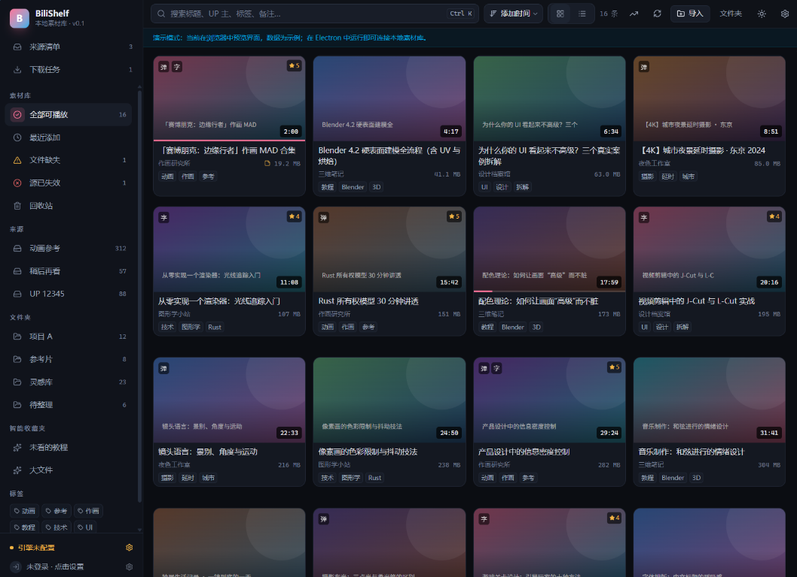

# BiliShelf

本地 B 站收藏夹素材库：**先拉清单、再选择性下载、最后像 Eagle 一样整理和播放**。

Windows 桌面 · 单机单用户 · 离线优先 · 数据全部在本机。

当前版本：**0.2.0**（2026-11-14）



---

## 现在能做什么

| 模块 | 已实现 |
| --- | --- |
| 素材库 | 网格 / 列表虚拟滚动、悬停缩略图、时长/评分/标签角标、批量选择 |
| 整理 | 标签增删、文件夹归类、1–5 星评分、备注、批量打标签 / 移动 / 评分 / 回收站 |
| 检索 | 标题 / UP / 标签 / 备注搜索（SQLite FTS5 trigram，短词回退 LIKE）、排序、状态筛选 |
| 导入 | 导入视频文件或递归导入文件夹；复制入库、ffprobe 探测、抽帧缩略图、写 sidecar |
| 播放 | 自定义 `bilishelf://` 协议 + Range；Artplayer；弹幕层；SRT/VTT 字幕；续播进度 |
| 下载 | yt-dlp 队列：持久化、并发限制、暂停/继续/取消/重试、错误分类、进度事件；默认下载**最高画质（4K/8K 优先，同规格优先 H.264）**；先下到 `cache/temp/downloads/job-<id>`，成功后再提升到正式目录；完成后素材库与来源清单自动刷新；支持检查已下载视频的画质升级（更高分辨率或视频码率），确认后覆盖升级 |
| 来源 | 收藏夹、稍后再看、UP 主 / 合集；先同步列表与元数据，**不自动下载**；封面以 640px JPEG 缓存到本地；卡片 / 表格视图、来源备注、单来源「参与同步全部」开关；同步/下载全部均显示进度并可取消；支持「全部下载」单个来源或所有收藏夹；已下载条目显示画质 / 编码 / 体积 |
| 媒体库 | 可选生成 `movie.nfo` + `poster.jpg`（默认关闭）；下载完成后可生成 4 秒悬停预览片（默认开启） |
| 维护 | 从 sidecar 重建索引、搬库、日志目录、引擎自检；补全旧视频 cid / 弹幕、生成悬停预览、压缩封面缓存、清理 `.info.json` 与重复缩略图 |

> 侧栏的「全部可播放 / 最近添加 / 文件缺失 / 源已失效 / 回收站」是互斥的**作用域**（状态 + 排序）；
> 选中标签或文件夹时属于**细分筛选**，作用域高亮会让位，顶栏会显示可清除的筛选条。

## 实测状态（2026-11-14）

已用真实账号跑通：

- 登录态读取（`nav` → 昵称 / UID）
- 收藏夹列表拉取（含条目较多的默认收藏夹）
- 单收藏夹清单同步（含自动标记失效条目）
- 单条 1080P 真实下载：yt-dlp → ffmpeg 合并 → ffprobe → 封面 / 字幕 / 缩略图 → 自动标签 → sidecar → 内置播放（含字幕）全链路通过
- 界面操作：搜索（FTS + 短词回退）、选中 / 检查器、加标签、评分、批量操作、回收站 / 恢复 / 彻底删除
- 下载队列：界面入队 → 下载完成、暂停 → 继续 → 取消、任务页「在素材库中查看」
- 下载完成后素材库 / 来源清单自动刷新（事件合并为 400ms 一次）
- 画质升级：真实视频扫描到更高分辨率候选，确认后以最高画质覆盖并清理旧文件
- 封面：同步后以 640px JPEG 缓存到 `cache/covers/`，清单页离线可显示
- 设置：库目录（含整体迁移）、引擎检测、数据库备份、从 sidecar 重建索引、整理与修复
- 维护实测：161 个视频回填 cid，159 个弹幕落盘，161 个悬停预览生成；封面缓存 210MB → 14MB，媒体目录清理约 96MB 冗余文件

仍未验证 / 未实现：

- **稍后再看**：接口已接，测试账号列表为空。
- **ASS 字幕**：当前只挂了 SRT/VTT。
- **UP 主 / 合集来源**：走 yt-dlp 列取，未实测。
- **智能收藏夹编辑器**：能读取并应用规则，UI 只提供内置入口。
- **永久删除**只移除数据库记录，不会删磁盘文件（刻意保守）。

## 排障记录（踩过的坑）

| 现象 | 原因 | 处理 |
| --- | --- | --- |
| 收藏夹接口 `code:0` 但 `data:null` | 请求带了 `Origin` 头，被平台按跨域处理 | API 请求只带 `Referer`，不加 `Origin` |
| 下载进度 100% 但任务失败，`ERROR:` 后无内容 | CDN 对「非浏览器 UA + 单次长连接整文件下载」返回 `403/567` | yt-dlp 固定携带浏览器 UA，并加 `--http-chunk-size 1M` 分块请求 |
| 来源清单封面空白 | 封面是 `http://` 被 CSP 拦截；或 CDN 抖动、离线 | 入库统一升级 https；同步后把封面缓存到 `cache/covers/`，列表改用 `bilishelf://cover/<id>` |
| 来源封面全部显示为破图 | B 站 CDN 对 `localhost` / `file://` 的 Referer 返回 403 | 页面加 `<meta name="referrer" content="no-referrer">`，图片请求不带 Referer |
| 取消下载后留下半截文件 | 用了 `--no-part`，中断的 mp4 看起来是完整的 | 改回 `.part` 临时文件；取消时若目录里没有完整视频，整目录删除（含封面/字幕/info） |
| 重新加入队列没反应 | 上次中断的任务被标记为 `paused`，`enqueue` 直接跳过 | 暂停中的任务再次入队时自动恢复 |
| 下载被中途打断 | 上一次残留的 `BILISHELF_CAPTURE` 环境变量让应用自动退出 | 调试钩子只在显式设置时生效，跑下载前清空相关变量 |
| 截图里圆角背景“变高/错位” | `capturePage()` 在 Windows 125% 缩放下偶发的合成偏差，不是真实渲染问题 | 视觉验收改用系统级 `PrintWindow` 截图 |
| 弹幕一直为空、sidecar 里 cid 是 `null` | yt-dlp 的 `info.json` 不包含 `cid`，旧版本直接读了不存在的字段 | 下载后用 `x/web-interface/view` 补 cid；设置 → 整理与修复 →「补全 cid / 弹幕」可回填旧视频 |
| 4K 显示成 `2160P`、竖屏 1080×1920 显示成 `1920P` | 分辨率标签只用了 `height` | 统一用短边 + `4K / 2K / 1080P / 720P` 映射，竖屏追加「竖屏」 |
| 封面缓存占用越来越大 | 缓存的是 B 站原图（平均 ~600KB） | 缓存时压成 640px JPEG；设置 →「压缩封面缓存」可重建旧缓存 |
| 下载失败 / 取消后 media 里留下半截文件 | 直接下载到正式目录 | 先下载到 `cache/temp/downloads/job-<id>`，成功后才提升；取消时清理暂存 |
| 画质升级后视频多嵌套一层 `upgrade-<id>/` | 升级任务直接用了子目录作为输出目录 | 所有任务统一走暂存目录，成功后按 `BV_CID` 正式目录替换旧文件 |
| 播放器弹幕报 `Cannot read properties of undefined (reading 'context')` | 弹幕层在 Artplayer 初始化前挂载，canvas 引擎拿不到 2D context | 弹幕层改到播放器初始化后挂载，并切换到 DOM 引擎 |


## 下载 / 安装

从 [GitHub Releases](https://github.com/YYY7C/BiliShelf/releases) 下载：

| 产物 | 说明 |
| --- | --- |
| `BiliShelf-<版本>-setup.exe` | NSIS 安装版：可选目录、创建快捷方式，卸载不删素材库 |
| `BiliShelf-<版本>-portable.exe` | 便携版单文件：双击即用，素材库放在 exe 同级 |

安装包已内置 yt-dlp / ffmpeg / ffprobe，目标机器无需额外安装。未配置代码签名，首次运行 SmartScreen 可能提示，选「仍要运行」即可。

版本变化见 [CHANGELOG.md](CHANGELOG.md)；从源码构建见下文「快速开始」与「打包成 EXE / 便携版」。

## 快速开始

要求：

- Node.js **>= 22.12**（本项目在 Node 22.21 / Electron 45 上开发）
- Windows 10 / 11
- 下载功能需要 `yt-dlp.exe` 与 `ffmpeg.exe` / `ffprobe.exe`（放在 PATH、`resources/bin`，或在设置里指定）

```powershell
npm install
npm run dev          # 开发模式（Vite + Electron）
npm run typecheck    # 主进程 + 渲染进程类型检查
npm test             # Vitest 单元测试
npm run lint         # ESLint
npm run build        # 产物输出到 out/
npm run dist         # 打包 NSIS 安装版 + 便携版（输出到 release/）
```

> 不需要 Visual Studio：数据层使用 Electron 内置的 `node:sqlite`，没有 better-sqlite3 之类的原生模块。

## 快捷键

| 快捷键 | 作用 |
| --- | --- |
| `Ctrl / Cmd + K` | 聚焦素材库搜索 |
| `Space` | 播放当前选中的素材 |
| `Delete` | 将选中素材移入回收站 |
| `Esc` | 关闭播放器 / 弹窗 |

顶栏右侧可切换深色 / 浅色主题。

## 整理与修复

「设置 → 素材库 → 整理与修复」提供四个维护动作（执行前建议先点「备份数据库」）：

| 动作 | 作用 |
| --- | --- |
| 补全 cid / 弹幕 | 为旧版本下载的视频回填 cid（弹幕、分 P 去重需要），补下弹幕，并用 ffprobe 重新读取视频流码率 |
| 生成悬停预览 | 为已有视频补 4 秒静音预览片（每个约 200–500KB） |
| 压缩封面缓存 | 把 `cache/covers/` 里的原图压成 640px JPEG |
| 清理冗余文件 | 删除 yt-dlp 的 `.info.json`、与 `cover.jpg` 同尺寸的重复缩略图，以及残留的 cookies / 下载暂存 |

## 打包成 EXE / 便携版（已内置引擎）

`npm run dist` 会产出两个文件（`release/`）：

| 产物 | 说明 |
| --- | --- |
| `BiliShelf-0.2.0-setup.exe` | NSIS 安装版：可选安装目录、创建快捷方式、卸载不删素材库 |
| `BiliShelf-0.2.0-portable.exe` | 便携版单文件：双击即用，无需安装 |

**运行时依赖已一起打包**，目标机器不需要装 Python / ffmpeg / yt-dlp：

```
resources/bin/           ← 打进安装包的引擎（extraResources → <app>/resources/bin）
├─ yt-dlp.exe            独立版（非 pip 的 launcher，约 23 MB）
├─ ffmpeg.exe            约 122 MB
└─ ffprobe.exe           约 121 MB
```

这些二进制没有进版本库（`.gitignore` 里忽略了 `resources/bin/`），换机器后先跑一次：

```powershell
powershell -ExecutionPolicy Bypass -File scripts\prepare-engines.ps1 -Proxy http://127.0.0.1:<端口>
# 或者指定本机 ffmpeg 目录
#   -FfmpegDir <包含 ffmpeg.exe 的目录>
```

引擎查找顺序：**设置里的自定义路径 → 内置 `resources/bin` → 系统 PATH**，所以内置引擎优先，用户仍可在设置里覆盖。

打包相关约定：

- 素材库默认位置 = 程序启动目录
  - 安装版：exe 所在目录（装在 `Program Files` 不可写时自动退回 `%APPDATA%`）
  - 便携版：**你双击的那个 `.exe` 所在目录**（读取 `PORTABLE_EXECUTABLE_DIR`，不会把库丢进临时解压目录）
- 便携版解压目录固定为 `BiliShelf`（`portable.unpackDirName`），避免每次启动重新解压
- 未配置代码签名证书时自动跳过签名；首次运行 SmartScreen 可能提示，选「仍要运行」即可
- 因为引擎有 265 MB，安装包约 130–150 MB（7z 压缩后），安装后约 350 MB

如果你想要**不带引擎的瘦身版**（让用户自备 yt-dlp/ffmpeg，或在设置里指定），把 `package.json` 里的 `extraResources` 删掉再打包即可。

## 目录结构

```
src/
├─ main/                 主进程
│  ├─ db/                node:sqlite 连接、迁移、videos/tags/sources/jobs 仓储
│  ├─ engine/            yt-dlp 进程封装、工具探测
│  ├─ services/          下载队列、来源同步、登录、媒体处理、sidecar、NFO
│  ├─ protocol.ts        bilishelf://（Range / CORS / 路径校验）
│  ├─ ipc.ts             IPC 契约与 zod 校验
│  ├─ store.ts           userData/config.json（库路径、画质、引擎路径）
│  └─ index.ts           窗口、CSP、安全策略、生命周期
├─ preload/              contextBridge 白名单 API
├─ shared/               主进程 ↔ 渲染进程类型与通道常量
└─ renderer/src/
   ├─ components/        侧栏、顶栏、网格、检查器、播放器、来源、任务、设置
   ├─ lib/               bridge（含浏览器演示数据）、格式化、弹幕解析、zustand store
   └─ App.tsx
```

## 素材库结构

```
<libraryRoot>/
├─ library.db                 SQLite 索引（可从 sidecar 重建）
├─ media/<年>/<来源>/<BV>_<CID>/
│  ├─ video.mp4
│  ├─ cover.jpg
│  ├─ subtitle.srt
│  ├─ danmaku.xml
│  ├─ movie.nfo               （可选）
│  └─ metadata.json           sidecar：标题/UP/来源/标签/文件夹/评分/备注
├─ cache/covers/              640px JPEG 封面缓存
├─ cache/thumbnails/          缩略图缓存
├─ cache/temp/                cookies / 下载暂存（任务结束即删）
├─ backups/
└─ logs/
```

默认库路径 = **程序启动目录**（开发模式即项目目录，打包后在 exe 同级；若不可写会退回 `%APPDATA%`）。
在「设置 → 素材库」可以一键迁移到别处（会连同 `media/`、数据库、缓存一起搬走）。

> 因为素材库就在程序目录里，`.gitignore` 已忽略 `library.db* / media / cache / backups / logs`。

## 关键设计取舍

1. **下载引擎是外设**：yt-dlp 以独立进程运行，失败/升级不影响素材库；接口变化只改 `engine/ytdlp.ts`。
2. **数据库是索引，sidecar 是真相**：`metadata.json` 随视频目录走，搬库/换机可重建。
3. **先清单后下载**：同步只拉列表与元数据，勾选后才入队；降低风控、带宽与存储压力。
4. **安全边界**：渲染进程沙箱 + contextIsolation；文件只通过 `bilishelf://` 暴露，并做路径穿越校验；Cookie 只在主进程使用，导出给 yt-dlp 的临时文件任务后删除。
5. **不绕过访问控制**：只处理当前账号可正常播放的内容；遇到会员/付费/地区限制直接跳过并提示。

## 开发工具

```powershell
npm run seed:demo     # 生成 8 个测试视频 + 缩略图并写入当前素材库（便于联调）
```

截图钩子（仅未打包时生效）：

```powershell
$env:BILISHELF_CAPTURE="$PWD\shot.png"
$env:BILISHELF_CAPTURE_JS='document.querySelector("main img")?.closest("[class*=rounded-xl]")?.dispatchEvent(new MouseEvent("click",{bubbles:true}))'
& .\node_modules\electron\dist\electron.exe .
```

## 附带的油猴脚本：B 站动态短视频过滤 + 快速收藏

`bilibili-dyn-filter.user.js` 是一个独立于 BiliShelf 桌面端的用户脚本（MIT），安装到 Tampermonkey / Violentmonkey 后作用于 `t.bilibili.com`：

- **过滤**：隐藏时长小于 N 秒的视频动态，阈值可在右下角面板调整并持久保存。
- **快速收藏**：在视频动态的操作栏注入「收藏」按钮，可直接多选收藏夹 / 新建收藏夹 / 取消收藏，无需跳转视频页。
- **悬停预览**：鼠标停留约 0.3 秒后卡片放大并静音循环播放，放大程度 100% ~ 130% 可调。
- **一键下载**：默认 1080P，可切换 1080P+ / 720P / 480P / 360P / 仅音频（m4a）；音视频由 Mediabunny 在浏览器内合并，无需 ffmpeg。

脚本只用浏览器当前登录态调用官方接口，不上传任何数据；下载同样遵循下面的「使用边界」。

安装：在油猴管理器中新建脚本并粘贴 `bilibili-dyn-filter.user.js` 的内容，或直接把文件拖进浏览器。

## 使用边界

本项目是**非官方个人工具**，与哔哩哔哩无任何关联。仅用于备份你自己有权访问的内容：

- 不绕过登录态、会员/付费/充电内容、地区限制或 DRM；
- 不实现/传播签名与风控绕过，不高并发抓取；
- 不提供分享、再分发或公开服务；
- 请遵守平台用户协议与著作权法规，风险自负。

如果只想做备份而不需要整理：直接用 `bili-sync` + Eagle/Billfish 的组合更省事；本项目的价值在于“选择性同步 + 素材库体验”。

## 参考资料

- 预研文档：`docs/bili-shelf-pre-research.html`
- [yt-dlp](https://github.com/yt-dlp/yt-dlp) · [Artplayer](https://github.com/zhw2590582/ArtPlayer) · [Danmaku.js](https://github.com/weizhenye/Danmaku)
- [bili-sync](https://github.com/amtoaer/bili-sync)（同步/调度参考）
